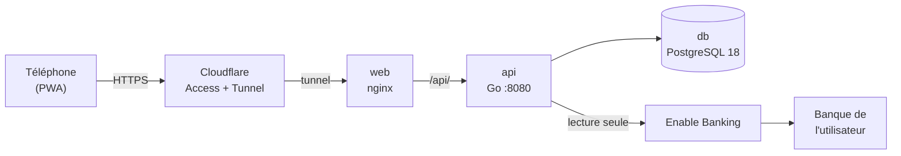
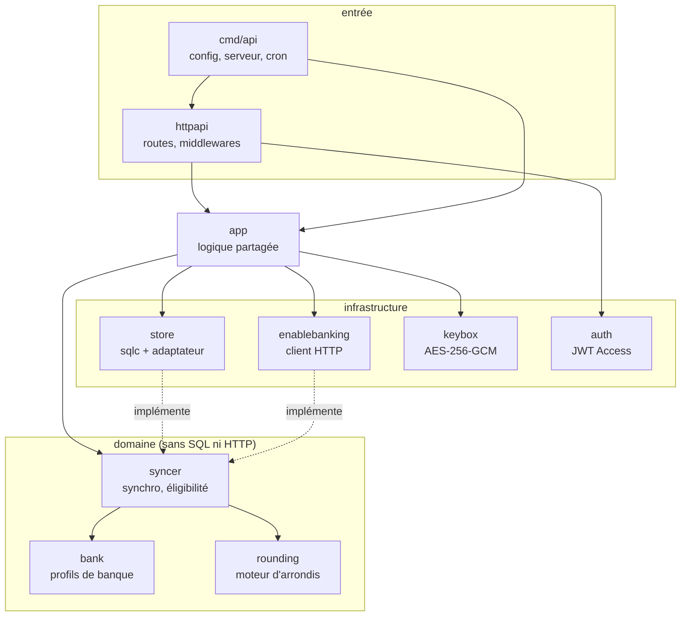
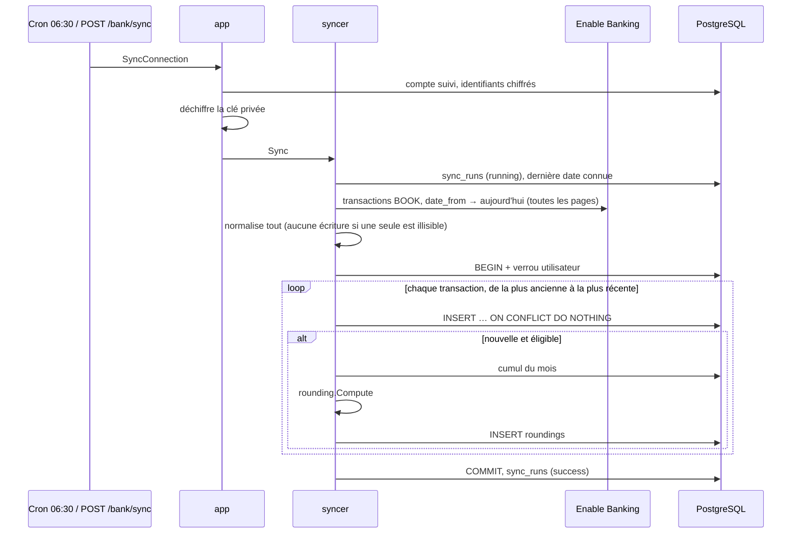
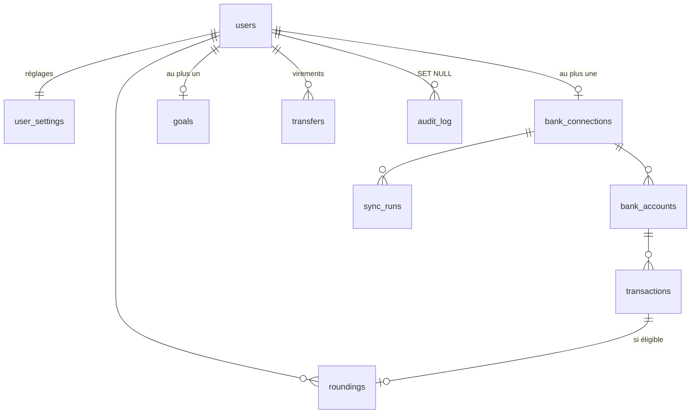

# Architecture de l'API

Ce document décrit comment l'API est construite. Le comportement attendu (règles d'arrondi, écrans, exigences) est défini par le cahier des charges ; en cas de divergence, le cahier des charges fait foi.

## Vue d'ensemble



- Le téléphone ne parle qu'à Cloudflare. Cloudflare Access authentifie l'utilisateur (code à usage unique par email) et ajoute à chaque requête un JWT signé (`Cf-Access-Jwt-Assertion`).
- nginx sert la PWA et relaie `/api/` vers l'API.
- L'API est la seule à appeler Enable Banking, avec les identifiants propres à chaque utilisateur (D-01).

## Couches



Les packages du domaine ne dépendent d'aucune infrastructure : `syncer` déclare les interfaces `Store`, `Tx` et `BankAPI`, que `store` et `enablebanking` implémentent. On teste ainsi toute la logique de synchronisation avec une fausse base et une fausse banque.

| Package | Responsabilité |
| --- | --- |
| `rounding` | `Compute(réglages, montant, cumul du mois)` → arrondi de base, brut, final et contrainte appliquée. `Settings.Validate` pour les plages de la section 4.1. |
| `bank` | Interface `Profile` (reconnaître la banque, comptes à synchroniser, paiement par carte, identifiant stable, durée de consentement). `Normalize` convertit une transaction Enable Banking. Profil `BoursoBank`. |
| `syncer` | `Service.Sync` : fenêtre de lecture, normalisation, éligibilité, arrondi, écriture en une transaction, statut de la connexion selon les erreurs. |
| `enablebanking` | Signature du JWT RS256, `/aspsps`, `/auth`, `/sessions`, `/accounts/{uid}/transactions` paginé, classement des erreurs. |
| `store` | Code généré par sqlc et `SyncStore` (adaptateur pour `syncer`, avec verrou par utilisateur). |
| `keybox` | Chiffrement des clés privées Enable Banking avec la clé maître. |
| `auth` | Vérification du JWT Cloudflare Access (signature, audience, émetteur, expiration), `DevVerifier` pour le local. |
| `app` | Déchiffrement des identifiants, synchronisation d'une connexion avec nouvelles tentatives, tâche quotidienne, création des utilisateurs. |
| `httpapi` | Routes huma de la section 7 et middlewares de la section 10. |

## Calcul d'un arrondi

Pour un montant `m`, un palier `p` et un multiplicateur `k` (tous en centimes sauf `k`) :

```
base  = (p − m mod p) mod p          0 si m est déjà un multiple de p (D-02)
brut  = base × k
final = min(brut, Ptx, R_mois)
R_mois = max(0, Pmois − arrondis finaux déjà enregistrés ce mois-ci)   illimité sans plafond mensuel
```

Exemple : 12,35 € au palier de 10 € avec un multiplicateur 2 → base 7,65 €, brut 15,30 €, final 15,30 € (sous le plafond de 20 €).

Le mois d'une transaction est celui de sa date de comptabilisation. Les transactions d'un même mois sont arrondies dans l'ordre de leur enregistrement (date de comptabilisation croissante, puis référence), ce qui rend le résultat du plafond mensuel déterministe. Un changement de réglage ne s'applique qu'aux transactions enregistrées ensuite (D-08) : chaque arrondi conserve le palier et le multiplicateur utilisés.

## Synchronisation



- **Fenêtre** : `date_from` = le plus tard entre le jour d'activation et la dernière transaction connue moins 7 jours ; `date_to` = aujourd'hui. Les 7 jours relus rattrapent les écritures tardives ; l'unicité (`account_id`, `external_id`) empêche les doublons.
- **Statut** : seules les transactions comptabilisées (`BOOK`) sont importées. Une opération en attente change de référence en passant comptabilisée.
- **Une seule fois** : une transaction déjà connue n'est jamais réarrondie.
- **Verrou** : `pg_advisory_xact_lock` par utilisateur ; deux synchronisations ne calculent jamais le même cumul mensuel en même temps. En plus, l'application refuse de lancer deux synchronisations de la même connexion.

## Éligibilité (section 4.2)

Une transaction est enregistrée dans tous les cas ; elle n'est arrondie que si aucun motif d'exclusion ne s'applique. Les motifs sont évalués dans cet ordre :

| Code | Cas |
| --- | --- |
| `credit` | Crédit (remboursements compris, D-07) |
| `foreign_currency` | Devise autre que l'euro |
| `zero_amount` | Montant nul |
| `before_activation` | Comptabilisée avant le jour d'activation (D-09) |
| `not_card` | Pas un paiement par carte (règle du profil de banque, D-06) |
| `cash_withdrawal` | Retrait d'espèces (banques qui le distinguent) |
| `untracked_account` | Compte non suivi |

## Profil BoursoBank

Constats du J1 (7 novembre 2026), codés dans `internal/bank/boursobank.go` :

| Point | Valeur |
| --- | --- |
| Nom ASPSP | `Boursorama Banque` |
| Consentement maximal | 15 552 000 s (180 jours) |
| Comptes de la session | Compte courant (`CACC`) **et** carte (`CARD`) ; chaque paiement par carte apparaît dans les deux. On ne synchronise que `CACC`. |
| Paiement par carte | Libellé qui commence par `CARTE ` (ex. `CARTE 04/11/26 TOTAL 4 CB*6804`) |
| Identifiant stable | `entry_reference` (`transaction_id` toujours nul) ; une référence `avis-…` est provisoire |
| Montants | Chaînes (`"24"`, `"105.42"`), sens dans `credit_debit_indicator` |
| Devise du compte | `XXX`, enregistrée comme `EUR` |

## Modèle de données



| Table | Contenu | Points clés |
| --- | --- | --- |
| `users` | email, nom, rôle (`admin`/`member`), actif | email en minuscules, unique |
| `user_settings` | palier, multiplicateur, plafonds | contraintes CHECK = plages de la section 4.1 ; `month_cap_cents` NULL = sans plafond |
| `bank_connections` | profil (`bank_code`), identifiants chiffrés, session, consentement, état d'autorisation, dernière synchro | une par utilisateur ; `activated_at` fixée au premier consentement, jamais modifiée |
| `bank_accounts` | uid Enable Banking, 4 derniers caractères de l'IBAN, libellé, devise | un seul compte suivi par connexion (index unique partiel) |
| `transactions` | date, montant absolu, sens, libellé, éligibilité, motif, réponse brute | unique (`account_id`, `external_id`) ; `is_eligible` ⇔ motif nul |
| `roundings` | réglages utilisés, base, brut, final, contrainte (`limited_by`), mois | jamais modifiée ; final ≤ brut |
| `transfers` | montant, date | virements faits à la main |
| `goals` | nom, cible, date facultative | au plus un par utilisateur |
| `sync_runs` | déclencheur, statut, compteurs, erreur | trace de chaque exécution, sert aux quotas EF-10 |
| `audit_log` | action, détail sans donnée personnelle | conservé 12 mois |

Toutes les clés étrangères vers `users` sont en cascade (EF-30) : supprimer un utilisateur supprime toutes ses données. Supprimer la connexion bancaire supprime comptes, transactions et arrondis (EF-08).

Pour modifier le schéma : ajouter un fichier `db/migrations/0000N_description.sql` (sections `-- +goose Up` et `-- +goose Down`), puis `make migrate` et `make sqlc`. Ne jamais modifier une migration déjà appliquée en production.

## Ajouter une banque

1. Avec un utilisateur volontaire, relever ses transactions brutes (programme `api-j1/` ou synchronisation) et remplir la fiche de mapping : nom ASPSP, comptes exposés, règle de paiement par carte, identifiant stable, durée de consentement.
2. Créer `internal/bank/<banque>.go` qui implémente `Profile` (et `DefaultNamer` si la banque n'a qu'un nom ASPSP).
3. Écrire ses tests sur un extrait anonymisé de ces transactions.
4. L'ajouter à la liste `profiles` de `internal/app/app.go` et à l'`enum` de `bank_code` dans `internal/httpapi/bank.go`.
